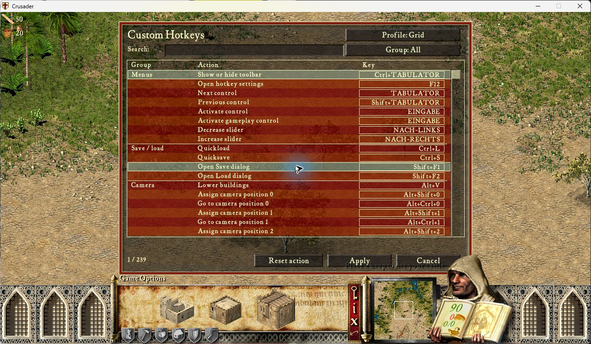

# Custom Hotkeys

Gestalte die Steuerung von Crusader so, wie du spielst. Wähle Spielstandard, Moderne RTS-Steuerung oder Raster und belege Tasten und Maustasten neu. Raster folgt dem geöffneten Bau- oder Einheitenmenü, sodass dieselben Tasten dort unterschiedliche Aktionen auslösen können.

Öffne **Optionen > Eigene Tastenkürzel** im Haupt- oder Pausenmenü oder drücke während des Spiels **F12**. Wähle eine Aktion und drücke **Eingabe**, um eine Taste oder Maustaste zuzuweisen; **Entf** entfernt die Belegung und **Übernehmen** speichert deine Auswahl in der aktiven UCP-Konfiguration. Auch Kamerapositionen, Gruppen, Gebäudeplatzierung und Einheitenbefehle findest du hier.

