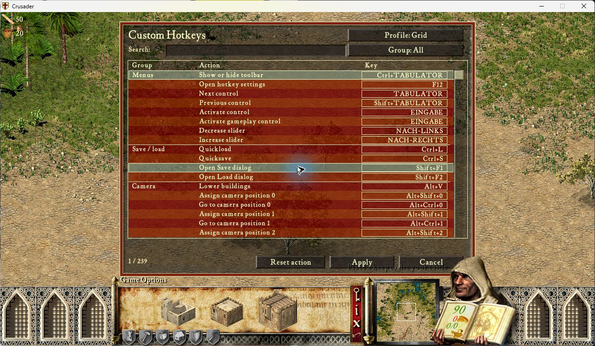

# Custom Hotkeys 0.2.18

کنترل‌های Crusader را مطابق سبک بازی خود تنظیم کنید. از پیش‌فرض بازی، RTS نوین یا شبکه‌ای شروع کنید؛ سپس کلیدهای صفحه‌کلید و دکمه‌های ماوس را دوباره اختصاص دهید و چیدمان‌های دلخواهتان را به‌صورت پروفایل ذخیره کنید. چیدمان شبکه‌ای با پنل بازِ ساختمان یا نیرو هماهنگ می‌شود تا همان کلیدها بتوانند در هر پنل عملکرد متفاوتی داشته باشند.

از منوی اصلی یا منوی مکث، **گزینه‌ها > میانبرهای سفارشی** را باز کنید یا هنگام بازی **F12** را بزنید. یک عملکرد را انتخاب کنید و **Enter** را بزنید تا کلید یا دکمهٔ ماوس را به آن اختصاص دهید؛ **Delete** انتساب را پاک می‌کند و **اعمال** پروفایل را ذخیره می‌کند. موقعیت‌های دوربین، گروه‌ها، ساخت ساختمان و فرمان‌های نیروها نیز در همین ویرایشگر تنظیم می‌شوند.

