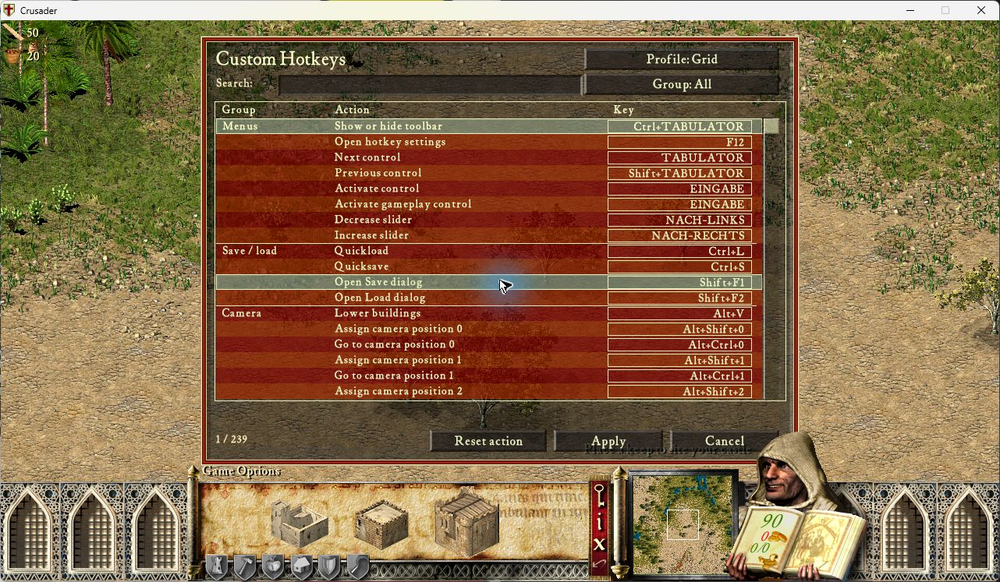

# Custom Hotkeys 0.2.18

Alakítsd a Crusader irányítását a saját játékstílusodhoz. Válaszd a Játék alapértékei, a Modern RTS vagy a Rács kiosztást, majd állítsd át a billentyűket és az egérgombokat, és mentsd el a kiosztást profilként. A Rács az éppen nyitott építési vagy egységpanelt követi, így ugyanazok a billentyűk más-más műveletet indíthatnak.

Nyisd meg a **Beállítások > Egyéni gyorsbillentyűk** menüpontot a főmenüből vagy a szünet menüjéből, vagy játék közben nyomd meg az **F12**-t. Válassz ki egy műveletet, majd az **Enter** megnyomása után adj meg egy billentyűt vagy egérgombot; a **Delete** törli a hozzárendelést, az **Alkalmaz** pedig menti a profilt. Itt állíthatod be a kamerapozíciókat, csoportokat, épületelhelyezést és egységparancsokat is.

