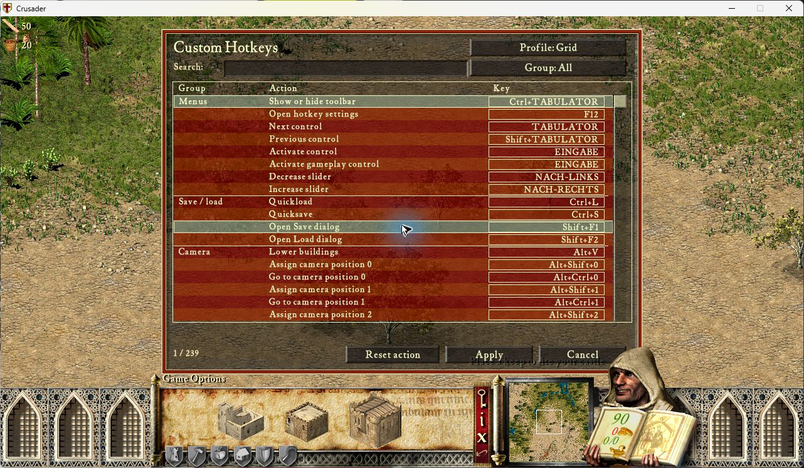

# Custom Hotkeys 0.2.18

Crusader kontrollerini oyun tarzınıza göre düzenleyin. Oyunun varsayılanı, Modern RTS veya Izgara ile başlayın; ardından klavye kısayollarını ve fare tuşlarını yeniden atayıp düzenlerinizi profil olarak kaydedin. Izgara, açık olan inşaat veya birim panelini izler; böylece aynı tuşlar farklı eylemler için kullanılabilir.

Ana menüden veya duraklatma menüsünden **Seçenekler > Özel Kısayollar** bölümünü açın ya da oyun sırasında **F12**'ye basın. Bir eylem seçip **Enter**'a bastıktan sonra bir tuş veya fare düğmesi atayın; **Delete** atamayı temizler, **Uygula** profili kaydeder. Kamera konumları, gruplar, bina yerleştirme ve birim emirleri de bu düzenleyicide ayarlanır.

